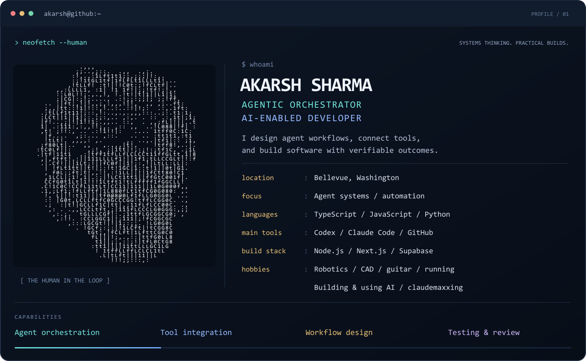
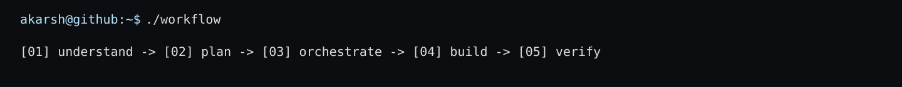

  

I build agent workflows and AI-enabled software, connecting clear requirements, tools, implementation, and verification. My projects span portable agent skills, robotics tooling, adaptive learning, and public-source research.

### `$ cat toolbox`

| Tools | How I use them |
| :--- | :--- |
| **Codex · Claude Code** | Agent-assisted development, workflow orchestration, repository work, and review |
| **GitHub · GitHub Actions** | Version control, open-source projects, and automated checks |
| **TypeScript · JavaScript · Python · Node.js** | Application logic, integrations, CLIs, and automation |
| **Next.js · Tailwind CSS · Supabase** | Web interfaces, data, authentication, and backend functions |
| **Onshape · FRC/FTC tooling** | CAD workflows, mechanism research, and evidence-backed scouting |

### `$ describe skills`

**Agent orchestration** — define goals, select tools, coordinate tasks, and retain useful context.  
**Workflow engineering** — turn repeatable processes into portable skills and deterministic tooling.  
**Software development** — build interfaces, integrations, state engines, and automation.  
**Verification** — use tests, source evidence, and explicit acceptance criteria to assess results.

### `$ cat interests`

Robotics · CAD · Guitar · Running · Building & using AI · Claudemaxxing

Based in Bellevue, Washington. Explore my four pinned projects below.

<!-- Design references: Andrew6rant/Andrew6rant; saivarun1410/termfetch; abhisheknaiidu/awesome-github-profile-readme. Custom composition and portrait; no source artwork copied. -->
