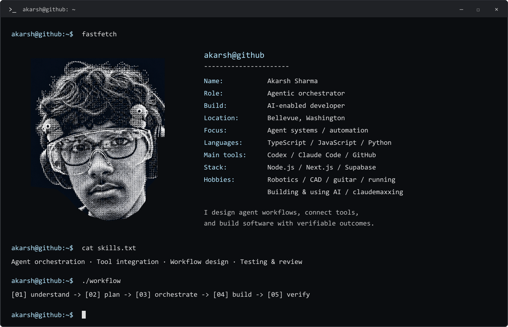
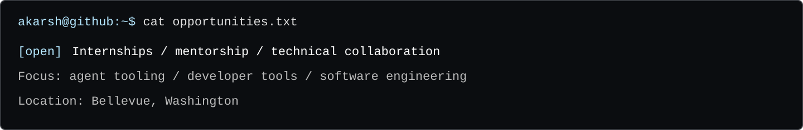

  <picture>
    <source media="(prefers-reduced-motion: reduce)" srcset="assets/profile.png" />
    
  </picture>

I build agent workflows and AI-enabled software, with an emphasis on tool integration, durable state, and verifiable results. My public work spans developer tooling, robotics workflows, adaptive learning, and web applications.

[**Review the engineering →**](PORTFOLIO.md) · [**Discuss an opportunity →**](https://github.com/AkarshSharma2012/AkarshSharma2012/issues/new?template=opportunity.yml)

### `$ ls projects/`

| Project | Engineering focus | Start reviewing |
| :--- | :--- | :--- |
| **[Autopilot](https://github.com/AkarshSharma2012/autopilot-skill)** | Portable agent workflows and signed output receipts using Ed25519 and browser Web Crypto. | [Protocol](https://github.com/AkarshSharma2012/autopilot-skill/blob/main/skills/autopilot/scripts/lib/protocol.mjs) · [Tests](https://github.com/AkarshSharma2012/autopilot-skill/blob/main/tests/protocol.test.mjs) |
| **[QuarryFind](https://github.com/AkarshSharma2012/QuarryFind)** | Public-source research with streamed results, source-health checks, and explicit failure states. TypeScript, Next.js, Supabase. | [Architecture](https://github.com/AkarshSharma2012/QuarryFind#how-it-works) · [End-to-end tests](https://github.com/AkarshSharma2012/QuarryFind/tree/main/e2e) |
| **[Live Mastery Tutor](https://github.com/AkarshSharma2012/live-mastery-tutor)** | Adaptive tutoring with a Python state engine, first-attempt records, and session recovery. | [State engine](https://github.com/AkarshSharma2012/live-mastery-tutor/blob/main/skills/live-mastery-tutor/scripts/tutor_state.py) · [Tests](https://github.com/AkarshSharma2012/live-mastery-tutor/blob/main/tests/test_tutor_state.py) |
| **[FRCstack](https://github.com/AkarshSharma2012/FRCstack-skill)** | Agent-guided FRC/FTC CAD workflows and evidence-backed scouting exports. Python and Excel tooling. | [Exporter](https://github.com/AkarshSharma2012/FRCstack-skill/blob/main/skills/frcstack/scripts/export_scouting.py) · [Workbook tests](https://github.com/AkarshSharma2012/FRCstack-skill/blob/main/tests/test_workbook.py) |

### `$ cat engineering-notes.md`

- **Make claims checkable.** Autopilot receipts bind a declaration to file contents; they establish integrity, not proof that AI was used.
- **Represent failure explicitly.** QuarryFind distinguishes a source that did not answer from a confirmed absence of a match.
- **Keep state outside the conversation.** Live Mastery Tutor preserves original attempt records and durable learning progress.
- **Tie reports to evidence.** FRCstack retains observations, sources, and unknowns alongside its scouting summaries.

### `$ tail lab-notebook.md`

**[Ram Lab](https://github.com/AkarshSharma2012/ram-lab) — research & planning.** Investigating agent fault injection, recovery verification, and claim-level evidence with detailed Excel reporting. The application has not been implemented; the repository documents the proposed scope and current status.

<code>cat toolbox.md</code> — tools, usage &amp; skills

| Tools | How I use them |
| :--- | :--- |
| **Codex · Claude Code** | Agent-assisted development, workflow orchestration, repository work, and review |
| **GitHub · GitHub Actions** | Version control, open-source projects, and automated checks |
| **TypeScript · JavaScript · Python · Node.js** | Application logic, integrations, CLIs, and automation |
| **Next.js · Tailwind CSS · Supabase** | Web interfaces, data, authentication, and backend functions |
| **Onshape · FRC/FTC tooling** | CAD workflows, mechanism research, and evidence-backed scouting |

**Agent orchestration:** define goals, select tools, coordinate tasks, and retain useful context.
**Workflow engineering:** turn repeatable processes into portable skills and deterministic tooling.
**Software development:** build interfaces, integrations, state engines, and automation.
**Verification:** use tests, source evidence, and explicit acceptance criteria to assess results.

**Outside the terminal:** Robotics · CAD · Guitar · Running · Building & using AI · Claudemaxxing

Interested in an internship, mentorship, or technical collaboration? <a href="https://github.com/AkarshSharma2012/AkarshSharma2012/issues/new?template=opportunity.yml">Start a conversation</a> with the team or project, what you are working on, and a public role or contact link.

<!-- Existing portrait, animation, terminal header, and pinned repositories intentionally preserved. Project descriptions grounded in public repository documentation. -->
